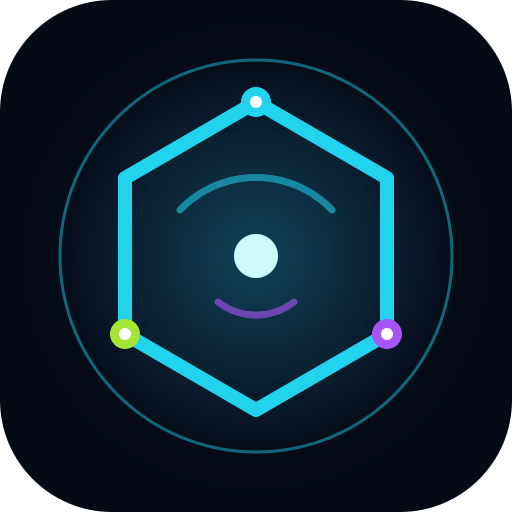

# IGRIS — Desktop Device Ecosystem

IGRIS is the **desktop half of a local-first device mesh** written in **Rust**.
It turns your PCs, laptops, and phones on the same LAN into one connected
ecosystem: sync your clipboard, mirror and reply to notifications, transfer
files of any size, and control calls/SMS on your linked phone — all without a
cloud server, an account, or an internet connection.

The desktop app is a Dioxus 0.7 shell that runs the shared protocol core
([`igris-protocol`](../igris-protocol)) **in-process**. `eco` and `fastswap`
in this binary *are* `igris_protocol::eco` and `igris_protocol::fastswap`,
re-exported from `src/lib.rs` — the desktop and the Android companion
([`igris-andriod`](../igris-andriod)) execute the identical protocol code, so
they cannot drift apart.



---

## Features

### Device Mesh
- **LAN Device Discovery** — Automatically finds every IGRIS instance on the local subnet:
  - Multi-interface /24 scan (IPs 1–254, up to 50 concurrent probes) against the HTTP and TLS ports — every usable local IPv4 interface's subnet is scanned (private ranges first), so multi-homed hosts (VPN, vEthernet, second NICs) never go blind; the probe host's own addresses on all interfaces are skipped to prevent self-discovery
  - 30-second heartbeat refresh; untrusted devices age out after 120 seconds; trusted devices persist as offline
- **Link & Trust** — Pair devices with a one-click link handshake over HTTPS; trusted (linked) devices are the only ones that receive clipboard, notification, call, SMS, and audio data
- **Stable Identity** — The device UUID is persisted (`pkg/device_id`) so links survive restarts; a fresh random ID per launch used to silently break every existing link until a manual re-pair
- **Encrypted Transport** — All peer traffic travels over TLS 1.3 (self-signed certs via `rcgen` + `rustls`), with a transparent TLS proxy terminating at each device's local HTTP service
- **Event-Driven Architecture** — A pub/sub event bus (`DeviceDiscovered`, `ClipboardChanged`, `NotificationReceived`, `DeviceTrusted`, …) lets features subscribe without touching the core
- **Persistent State** — Devices, trust lists, clipboard history (50 entries), and notification history (100 entries) stored as JSON under `pkg/ecosystem/`

### Universal Clipboard Sync
- **Automatic** — Clipboard text syncs across all linked devices in real time (1-second polling)
- **Media Support** — Base64 image/file clipboard payloads (config-gated via `clipboard_media`) alongside text
- **Loop-Proof** — SHA-256 content hashing plus a two-marker diff (`last_content_hash` / `last_applied_hash`) prevents echo broadcasts and feedback loops
- **Trust-Gated** — Only devices you've linked receive your clipboard
- **Platform-Native** — Win32 clipboard FFI on Windows, `pbpaste`/`pbcopy` on macOS, `xclip` on Linux

### Notification Sync
- **Mirror** — Notifications from any linked device appear in your notification center with device attribution, and as native toasts on Windows (inline reply + up to two action buttons included)
- **Reply from Anywhere** — Reply to mirrored notifications; quick-reply and action buttons are forwarded to the source device (`/notification/reply`, `/notification/action`)
- **Dismissal Following** — When the phone swipes a notification away, the mirrored desktop toast is removed (and local history updated) via `/notification/dismiss`
- **Icon Dedup** — Notifications carry app icons (base64 PNG, ≤96 px) with per-peer hash-skips so unchanged icons aren't re-sent
- **History** — Last 100 notifications persisted, with read/unread state

### Calls & SMS (phone companion bridge)
- **Call Mirroring** — Ringing / dialing / talking / ended events from a linked phone appear in the Calls panel
- **Remote Control** — Accept, decline, mute, end, and dial from the desk; audio stays on the phone
- **Call Log** — The phone's call history is mirrored to the desk (deduped by call ID)
- **SMS** — Send SMS through the phone's SIM slot from the Calls panel (multipart-aware); mirrored SMS events surface as notifications
- **Phonebook Search** — Debounced contacts search against the phone's address book for the desk dial pad

### LAN Call Audio
- **Desk as Handset Accessory** — When a linked phone carries a call, the desktop's mic and speakers can join the call over the LAN (the phone pairs the desk like a Bluetooth handsfree)
- **Realtime Only** — Raw duplex `s16le` mono PCM, 48 kHz, 10 ms frames over a single raw TCP socket (port 53329); congestion drops frames instead of blocking
- **Parked Routing** — A route requested before the line goes live is parked and applied on the next call event (answer may beat the telephony transition)
- **Trust-Gated** — Only linked peers' IPs are accepted into the audio session

### FastSwap File Transfer
- **Igris Native v1** — `/api/fastswap/v1/*` three-way handshake (info → register → prepare-upload → confirm-upload → upload); legacy `/api/localsend/v2/*` route aliases are kept for compatibility with earlier builds and LocalSend-style peers
- **TLS Encrypted** — Self-signed TLS termination on a dedicated proxy port
- **Approval Flow** — Incoming transfers show a full-screen accept/deny popup with a 60-second approval window
- **Live Progress** — Per-file progress, transfer speed, and ETA for both sender and receiver; cooperative cancellation per session
- **Folders Preserved** — Send whole directories; relative folder structure is recreated on the receiving side
- **Smart File Handling** — Path-traversal sanitization, conflict renaming (`name (1).ext`), MIME detection, and chunked streaming (64 KB chunks)
- **10 GiB Body Limit** — Large transfers supported

### Cross-Platform Abstraction Layer
- **PlatformClipboard** — Win32 FFI / `pbpaste` / `xclip`
- **PlatformNotification** — NotificationCenter scraping (macOS), WinRT toast queries (Windows), D-Bus probe (Linux)
- **System Control** — Volume, brightness, power, WiFi, Bluetooth per OS
- **App Launcher** — Fuzzy-matched app registry with 50+ aliases per platform

### Desktop UI
The Dioxus 0.7 shell ships a sidebar (Devices / File Share / Notifications /
Calls / Alarms / Reminders / System) plus panels for:
- **Devices** — scan, link, unlink, and monitor your device mesh
- **File Share (FastSwap)** — transfer panel with device grid and live progress
- **Notifications** — center with cross-device replies, actions, and dismissals
- **Calls** — mirror + dial + call log + SMS compose, with phonebook search
- **Alarms & Reminders**, **Camera** (FFmpeg), **Presentation** (slides with TTS narration), and **System Info** utilities

> The AI/assistant stack (voice loop, STT/TTS, NLU, setup installer) has been
> split into a separate `igris-ai` crate; this repository is the mesh desktop
> shell and its platform engines.

---

## Architecture

```
src/
├── main.rs                      # Single-instance guard, mesh boot thread, Dioxus launch
├── lib.rs                       # Library exports; re-exports igris_protocol::{eco, fastswap}
├── config.rs / state.rs / processor.rs / voice.rs / platform_utils.rs
│                                # App config; legacy shims superseded by igris-ai / igris-protocol
├── ui/                          # Dioxus panels
│   ├── eco_device_panel.rs      #   Devices tab (scan, link, status)
│   ├── fastswap_panel.rs        #   File Share tab (send, progress, cancel)
│   ├── notification_panel.rs    #   Mirrored notifications + replies/actions
│   ├── calls_panel.rs           #   Calls: dial, accept/decline, log, SMS, contacts
│   ├── incoming_transfer_popup.rs
│   ├── settings.rs / sidebar.rs / theme.rs / menu_button.rs / search_results.rs
│   ├── alarm_reminder_panel.rs / system_info_panel.rs / camera_panel.rs / chat_panel.rs
│   └── presentation/            #   Full-screen slide viewer + narration
├── platform/                    # OS abstractions
│   ├── ecosystem/               #   Implementations of the igris-protocol platform seams
│   │   ├── windows.rs / macos.rs / linux.rs     # Clipboard
│   │   ├── notifications/                       # Notification readers per OS
│   │   ├── audio/                               # cpal/rodio LAN call audio (initiator role)
│   │   └── calls/                               # Local telephony line executor (Windows)
│   ├── app_launcher.rs / file_system.rs / process_builder.rs / system_control.rs
├── commands/                    # Utility handlers (system, files, web, reminders, camera)
├── plugins/                     # Built-in plugin registries (browsers, media, office, …)
├── media/                       # FFmpeg camera capture
├── setup_manager/               # Dioxus setup GUI (installer logic lives in igris-ai)
├── tools/ utils/
└── (eco/ + fastswap/ live in ../igris-protocol — imported, not duplicated)
```

### Networking Map

| Port  | Scheme | Service |
|-------|--------|---------|
| 53317 | HTTP   | FastSwap file transfer (local listener) |
| 53318 | TLS    | FastSwap TLS proxy (peer uploads/downloads) |
| 53327 | HTTP   | Ecosystem REST API (`/api/ecosystem/v1/*`) |
| 53328 | TLS    | Ecosystem TLS proxy (peer sync) |
| 53329 | TCP    | LAN call audio (desktop connects as initiator; the phone listens) |

`127.0.0.1:53329` is also the desktop's single-instance guard: a second
launch detects it, focuses the existing window, and exits.

### Ecosystem REST API

All routes are plain HTTP on the local listener (outbound peer calls use the TLS proxy). Full endpoint tables live in [`igris-protocol/README.md`](../igris-protocol/README.md); the desktop actively uses:

| Endpoint | Purpose |
|----------|---------|
| `GET  /api/ecosystem/v1/info` | Discovery probe — device identity + capabilities |
| `POST /api/ecosystem/v1/clipboard/sync` | Receive clipboard payload (text or media) from a peer |
| `POST /api/ecosystem/v1/pair/request` | Link handshake (trusts the requesting device) |
| `POST /api/ecosystem/v1/pair/untrust` | Unlink a device |
| `POST /api/ecosystem/v1/notification/sync` | Receive a mirrored notification |
| `POST /api/ecosystem/v1/notification/reply` | Forward a reply to the source device |
| `POST /api/ecosystem/v1/notification/dismiss` | Mirror a dismissal |
| `POST /api/ecosystem/v1/notification/action` | Fire an action button remotely |
| `POST /api/ecosystem/v1/call/sync` / `call/action` | Call events + remote call control |
| `POST /api/ecosystem/v1/call/log/sync` | Call-history mirror |
| `POST /api/ecosystem/v1/sms/sync` / `sms/send` | SMS mirror + send via phone SIM |
| `GET  /api/ecosystem/v1/contacts/search` | Phonebook search against a linked phone |
| `GET/POST /api/ecosystem/v1/audio/*` | LAN audio status / attach / detach / test tone |

FastSwap exposes `GET/POST /api/fastswap/v1/{info,register,prepare-upload,confirm-upload,upload}` (legacy `/api/localsend/v2/*` aliases included).

### Data Flow

```
Device A                                    Device B
┌───────────────────────┐                   ┌───────────────────────┐
│ ClipboardManager      │                   │                       │
│  (1s poll, hash diff) │                   │   ClipboardManager    │
│        │              │                   │   (1s poll, apply)    │
│        ▼              │                   │        ▲              │
│ SyncManager ──HTTPS───┼──── TLS 53328 ────┼──► HTTP 53327         │
│ (trusted peers only)  │                   │   (emit+apply)        │
│                       │                   │                       │
│ DiscoveryService      │◄══ subnet scan (HTTP 53327/TLS 53328) ══│ DiscoveryService      │
└───────────────────────┘                   └───────────────────────┘

Sender (FastSwap)                          Receiver (FastSwap)
  prepare-upload ──► session + file tokens ──► approval popup (60s)
  confirm-upload ◄──── approved ──────────────┘
  upload (64KB chunks) ──────────────────────► Downloads/ (sanitized,
                                               conflict-renamed, folders kept)

Desk (call audio initiator)                Phone (listener)
  dial/answer/mute ──► /call/action ────────► telecom stack (SIM)
  mic frames ─────────► TCP 53329 ──────────► AudioTrack (speaker)
  speaker playback ◄─── raw s16le 48k ─────── AudioRecord (mic)
```

---

## Quick Start

### Prerequisites
- Rust 1.75+
- Windows 10+, macOS 10.13+, or Linux (x86_64)
- 4 GB RAM (8 GB recommended)
- Devices must be on the same LAN/subnet

### Build & Run

```bash
git clone <repo-url> && cd igris-ecosystem
cargo run --release
```

First launch prepares `pkg/` — identity, ecosystem config, and TLS certs.
No model downloads are needed for the mesh itself (those belong to the
separate `igris-ai` assistant crate).

### Link Two Devices
1. Launch IGRIS on both devices (same network)
2. Open the **Devices** tab — each machine appears within one scan cycle (~30 s)
3. Click **LINK** on the peer — the handshake completes over HTTPS; both sides mark each other as trusted
4. Copy text on either device — it appears on the linked device's clipboard instantly

### Mobile Companions
Android phones join the same mesh through the native companion app
([`igris-android`](../igris-andriod)), which drives the shared protocol crate
([`igris-protocol`](../igris-protocol)) — identical wire protocol, so the
desktop discovers and links phones exactly like any other peer. Clipboard
from an Android background requires the app's gesture-detection machinery
(see its README); phone pushes arrive like any other peer's. Calls, SMS, and
LAN call audio likewise come from the phone side.

Field-verified mesh: **Windows desktop + POCO F6 (HyperOS) + iQOO I2501
(Funtouch OS)** — clipboard, discovery, and pairing across all three
(calls/SMS/audio ride the same shared core).

### Send Files
1. Open the **File Share** tab
2. **Scan Network** to find peers
3. **Select Files** or **Select Folder**
4. Click **Send** on the target device — the receiver gets a full-screen approval popup
5. Files land in the receiver's `Downloads` folder

---

## Configuration

### Ecosystem config — `pkg/ecosystem/ecosystem_config.json`

```json
{
  "enabled": true,
  "port": 53327,
  "auto_discovery": true,
  "clipboard_sync": true,
  "notification_sync": true,
  "call_sync": true,
  "sms_sync": true,
  "clipboard_media": true,
  "device_name": "MyPC",
  "storage_dir": "pkg\\ecosystem"
}
```

### Data & state — `pkg/`
| File | Contents |
|------|----------|
| `device_id` | This device's persistent UUID (stable across restarts — peers key their trust store by it) |
| `ecosystem/ecosystem_config.json` | Sync toggles (clipboard, notification, call, sms, media), device name, port |
| `ecosystem/trusted_devices.json` | Persistent linked-device IDs |
| `ecosystem/clipboard_history.json` | Last 50 clipboard entries (hash, content, source, timestamp) |
| `ecosystem/notification_history.json` | Last 100 notifications with read/replied state |
| `ecosystem/ecosystem_key.pem` / `.pub` | rcgen key pair + self-signed cert (device identity) |

### TLS certificates — `pkg/certs/`
Self-signed `fastswap_cert.der` / `fastswap_key.der` generated on first run (SAN `igris.local`).

---

## Development

```bash
cargo build            # debug
cargo build --release  # release
cargo test             # unit tests (transfers, sanitizers, protocol)
cargo run --release    # run
```

Notes:
- The mesh runs inside the main process on a dedicated thread/runtime — no separate daemon or service
- A second instance is detected (loopback port 53329) and focuses the existing window instead of silently running as an undiscoverable zombie
- Discovery scans every usable IPv4 interface's /24 (private ranges first, max 4 subnets, self-addresses skipped); cross-subnet setups can use manual IPs
- Outbound peer traffic always uses the TLS proxy ports; inbound arrives plaintext on the local listeners
- Session state (transfers, devices, history) is in-memory except the JSON stores listed above
- Startup diagnostics go to `startup.log` in the working directory

---

## Troubleshooting

| Issue | Solution |
|-------|----------|
| Devices not discovered | Same subnet required; allow ports 53317/53318/53327/53328 in the firewall; wait one 30 s scan cycle. Discovery scans **all** local interfaces' /24s, so VPN/virtual adapters no longer blind it |
| One device sees the other but not vice versa | The blind side picked a wrong network interface before — fixed by multi-interface scanning; also check the port-fallback trap below |
| Desktop invisible after relaunch | A second launch focuses the already-running window and exits by design (loopback guard on 53329). If you expected a fresh instance, close the running IGRIS first — a duplicate that somehow starts can't bind the mesh ports |
| Clipboard not syncing | Both devices must be **LINKED** (trusted); ensure `clipboard_sync: true`; links survive restarts via the persisted `pkg/device_id` |
| Clipboard media not syncing | Enable `clipboard_media` on **both** ends; media requires the peer capability flag |
| Calls/SMS not appearing | The phone must grant the opt-in call/SMS permissions; check `call_sync`/`sms_sync` in both configs |
| LAN audio won't connect | Only linked peers are accepted; the phone must be on the same subnet and its audio engine must be running (foreground service alive) |
| Transfer approval times out | The 60-second approval window expired — the sender sees a timeout |
| Files missing on receive | Check `~/Downloads`; conflict-renamed files get a `(1)` suffix |
| Notifications empty | Notification *reading* is platform-limited: macOS fully supported; Windows/Linux expose the API but system-level read-back may return nothing |
| Certificate errors | Self-signed certs are expected — the app accepts them by design on the LAN |
| Ports in use | Server and proxy retry across 10-port ranges and log the actual ports — but peers only scan the canonical ports, so a fallback instance is undiscoverable |

---

## Roadmap

- [x] LAN device discovery (multi-interface IPv4 subnet scan)
- [x] Link/trust handshake with persistent trust store
- [x] Persistent device identity (`pkg/device_id`) — links survive restarts
- [x] Universal clipboard sync (loop-proof, hash-diffed; text + base64 media)
- [x] Cross-device notification mirror + reply + dismiss + action buttons
- [x] FastSwap file transfer (native v1, TLS, approval flow, folders, cancel)
- [x] Cross-platform abstraction layer (clipboard, notifications, system control)
- [x] Android companion on the shared protocol core
- [x] Converged desktop onto the shared `igris-protocol` crate (no fork, single source of truth)
- [x] Calls — event mirror, remote control, call log, phonebook search
- [x] SMS bridge (send from desk via the phone's SIM)
- [x] LAN call audio link (desk as handset accessory, trust-gated)
- [ ] Image/file clipboard sync UX polish (protocol support landed)
- [ ] Transfer history persistence
- [ ] Remote input and media control between devices
- [ ] Relay mode for non-LAN (cross-subnet / internet) peers
- [ ] Session handoff and shared AI memory between devices
- [ ] Headless/CLI mesh node mode

---

## License

MIT
